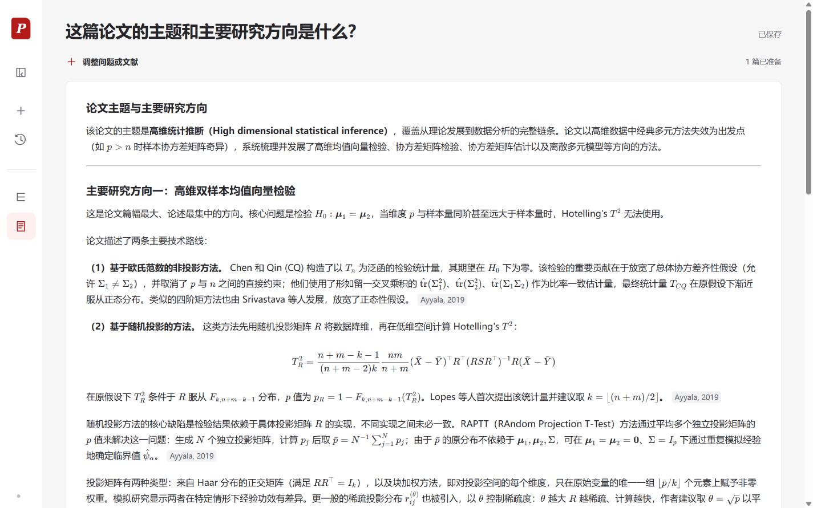

# PaperTrail

从检索论文，到可回溯原文的回答。

PaperTrail 是基于 arXiv 和 PaperQA2 的论文研究应用。检索、选择文献、准备索引和问答组成一条保存的研究记录；答案中的作者年份引用可以直接打开对应原文及固定版本 PDF。



*公开论文 1908.06600 的真实运行界面。截图展示阅读与引用能力，不代表答案事实支持已通过评测。*

## 可以做什么

- **检索论文**：中文问题生成英文检索词，可扩展多个 arXiv 查询并通过 RRF 融合；上游搜索失败时使用 OpenAlex 备用单路搜索，逐篇从 arXiv 核实摘要和固定版本，并标明备用来源。
- **按摘要筛选**：显式处理当前候选池，最多 60 篇、每批最多 10 篇。结果按阅读建议排列，同档保留检索顺序；失败项可单独补筛。
- **准备与问答**：选择最多 10 个固定版本，一次提交后由后台完成下载、解析、冻结和索引。可以调整当次参与回答的论文范围，其索引只包含所选论文。
- **证据组织与生成**：Agent 按需多轮检索证据，按问题生成证据提纲，再对照每条结论实际引用的原文复核条件和适用范围；程序绑定引用，评价标准保留原句，证据不足时说明具体缺口。
- **阅读与核查**：Markdown、表格、代码和 LaTeX 数学公式；段尾作者年份引用；按论文组织的折叠来源表、完整原文和固定版本 PDF。
- **研究历史**：保存检索、准备范围与答案，支持侧栏改名、刷新恢复和旧链接重开。仅浏览或修改勾选不会提交模型任务。
- **临时分享**：独立共享工作区、访问凭证和操作额度。模型密钥留在服务端，本机原历史不会复制给访客。

当前主要面向桌面浏览器，已检查 1440px 和 1280px 布局。

## 本机运行

需要 Python 3.12、Node.js 22.18 或更新版本、uv 和 Git。以下为 Windows PowerShell 命令；其他系统可以使用等价命令。

```powershell
git clone https://github.com/chencx2023/PaperTrail.git
cd PaperTrail
uv sync --locked
Copy-Item .env.example .env
```

编辑 `.env`，填入自己的聊天模型和嵌入服务凭据。模板为项目已接入的 DeepSeek 与 DashScope 兼容接口；模型名、地址、维度和批大小需要与实际账号一致。凭据缺失时可运行离线测试，但不能完成真实索引和问答。

构建前端：

```powershell
cd frontend
npm ci
npm run build
cd ..
```

明确初始化新的本地数据库，再同时启动 API 和执行器：

```powershell
$env:LITELLM_LOCAL_MODEL_COST_MAP = 'True'
uv run python -c "from pathlib import Path; from backend.app.db import open_database; open_database(Path('data/runtime/papertrail.sqlite')).dispose()"
uv run python scripts/run_papertrail.py --live
```

打开 **http://127.0.0.1:8766/**。终端保持运行，`Ctrl+C` 停止该启动器创建的 API 和执行器。默认数据保存在 `data/`；可以通过 `--database`、`--data-root` 和 `--port` 使用其他工作区。

`run_papertrail.py` 不带 `--live` 时只预览，不启动服务。真实检索、筛选、下载、嵌入和生成由用户明确操作触发，可能产生模型费用；普通刷新、历史重开和切换引用只读保存记录。不要同时为同一数据库启动两个执行器。

前端开发时，在另一个终端执行 `npm run dev`。Vite 的 `/api` 代理默认指向 8000，因此后台启动器需使用 `--port 8000`。

## 测试

```powershell
$env:LITELLM_LOCAL_MODEL_COST_MAP = 'True'
uv run python -m unittest discover -s tests -v
cd frontend
npm test
npm run build
```

测试使用隔离数据和替身，不需要真实模型请求。覆盖持久化任务、幂等提交、版本校验、失败恢复、固定文献范围、筛选分批与补缺、分享限额，以及引用和 Markdown 渲染。

## 临时分享

分享需要保持本机服务在线，并安装所选提供方需要的程序。已有 Cloudflare 二进制时可执行：

```powershell
uv run python scripts/share_papertrail.py --init-db --provider cloudflare --cloudflared PATH_TO_CLOUDFLARED --live
```

或使用系统 OpenSSH：

```powershell
uv run python scripts/share_papertrail.py --init-db --provider localhost.run --live
```

启动器在检查 HTTPS 访问凭证和执行器后，才把完整链接写入本机 `.tooling/share/access.json`。该文件包含私密访问凭证，不要上传。默认共享库在 `data/public-workspace/`，与普通工作区分离。免费地址可能变化，不保证长期在线；GitHub 仓库本身仅发布源代码。

每次分享服务限制准备 10 次、问答 10 次、摘要筛选 10 次、检索建议与扩展合计 20 次，并限制每分钟 20 次、总计 120 次修改请求。重试按原操作计数，后台自动衔接不重复计数。

停止分享：

```powershell
New-Item -ItemType File -Path .tooling/share/stop -Force
```

## 实现与资料

前端使用 React、TypeScript、Vite、react-markdown 和 KaTeX；后端使用 FastAPI、SQLAlchemy、SQLite 和持久化执行器。PaperQA2 固定到 `pyproject.toml` 中的上游提交，通过应用层适配模型配置、上下文选择、答案提示和证据保存，没有修改上游核心算法。

| 路径 | 内容 |
| --- | --- |
| `frontend/` | 两页研究界面、来源阅读与前端测试 |
| `backend/app/` | 检索、导入、索引、问答、历史与任务服务 |
| `scripts/` | 本机启动、分享、离线检查和任务恢复 |
| `tests/` | 后端回归与固定测试夹具 |
| `eval/` | 冻结开发案例与标注规则 |
| `docs/` | 公开实现说明、验证摘要与界面截图 |

可从[实现说明](docs/implementation.md)和[验证与质量边界](docs/verification.md)了解当前行为。离线 tokenizer 的来源、哈希和第三方许可见[说明](backend/app/qa/tokenizer/README.md)。内部交接、开发日志及本机运行产物不随公开快照发布。

## 当前边界

阅读建议不是经过校准的相关性评分；固定候选池和 arXiv 查询不能保证找到领域中的全部代表性文献。PDF 提取可能混排表格、公式或图注，物理页定位可能未知或有多个匹配。

回答没有固定的 300 字或 6 个片段上限，最终上下文仍受 24000 个本地估算 token 的预算约束。旧答案中没有数学定界符的文本不会被猜测改写。引用可映射到原文也不等于每个主张都得到充分支持；方法条件混用、过强比较结论和证据不足仍是已知质量问题。

历史六题首轮整题初判为 **2/6**；后续固定两篇论文的开发回归记录为 **6/6**。当前 v34 在另外九道有效开发题上，同一冻结版本每题执行一次，均通过要点与实际引用审阅（**9/9**）。这些题已经参与调试，属于开发修复验收，不能推断独立新题准确率；逐次运行日志留在本机，题目与结果范围见[验证摘要](docs/verification.md)。

仓库不包含 API Key、访问凭证、本机数据库、下载论文、运行历史或生成缓存。请使用自己的配置与数据运行。
